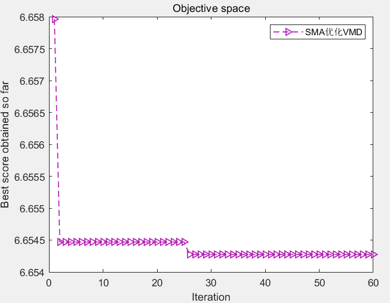
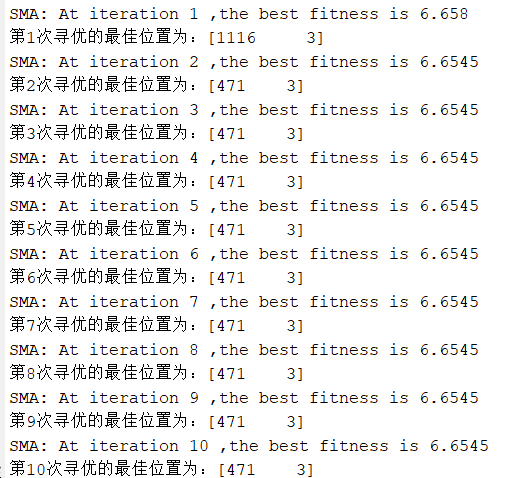
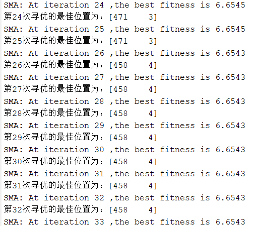
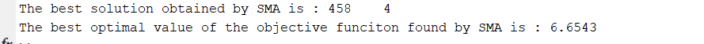

# Sticky-like Optimization Algorithm SMA, optimized for VMD, fitness function is minimum entropic envelope, including MATLAB source code.

Taking the Xichu University dataset as an example, we select the first 1024 data points from X105_BA_time.mat.
Firstly, we perform VMD decomposition, and employ the SMA (Sliding-Model Anomaly Detection) algorithm to optimize the two key parameters of VMD (penalty factor α and number of modes K), using minimum envelop entropy as the fitness value.
It's worth mentioning that the author has done a lot of work optimizing VMD with intelligent algorithms. The speed of the SMA is indeed fast. This is also related to the principle of the SMA. Unlike the Particle Swarm Optimization and Grey Wolf Optimization, which call the fitness function multiple times in each iteration, the SMA only calls the target function once per iteration.
As usual, let's show the results:
\n        \n      \n        \n      \n        \n      \n        \n      Partial code:   
%%\n%% The objective function is the minimum envelop entropy, and the SMA algorithm is used to optimize VMD to find the optimal two parameters of VMD.\nclear all\nclc\naddpath(genpath(pwd))\nload 105.mat\nD=2;             % Optimize the number of variables\nlb = [100 3];\nub = [2500 10];\ndim = 2;\nMax_iter=60;       % Maximum number of iterations\nN=15;       % Population size\nfobj=@Cost;\nda = X105_DE_time(1:1024); % Here, select the DEtime data of 105\n \n[Destination_fitness,bestPositions,Convergence_curve]=SMA(N,Max_iter,lb,ub,dim,fobj,da);\n \n%Draw fitness function graph\nfigure\nplot(Convergence_curve,'Color',[0.7 0.1 0.7],'Marker','>','LineStyle','--','linewidth',1);\n \ntitle('Objective space')\nxlabel('Iteration');\nylabel('Best score obtained so far');\nlegend('SMAOptimizationVMD')\ndisplay(['The best solution obtained by SMA is : ', num2str(round(bestPositions))]);  % Output the best location\ndisplay(['The best optimal value of the objective funciton found by SMA is : ', num2str(Destination_fitness)]);  % Output the best fitness value\n  

## Images

<!-- PAYMENT_BLOCK -->

## Get this dataset

- Payment link (Stripe): [Buy now](https://buy.stripe.com/3cs8yP7sY87d0vu9AB)
- Payment QR code: 

<!-- /PAYMENT_BLOCK -->
